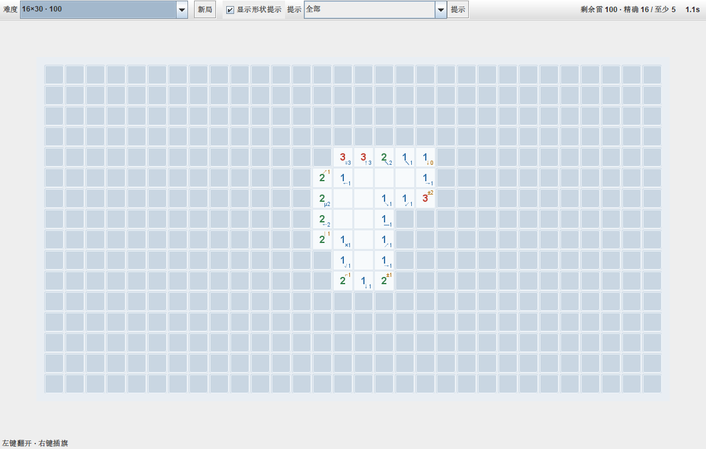

# SignedMine

带「形状提示」的扫雷。纯桌面：一个 Swing 桌面版，一个单文件网页版。

[](LICENSE)
[](src/Sweeper.java)
[]()
[](https://nesarf.github.io/SignedMine/)



不用下载也能玩：[**打开网页版**](https://nesarf.github.io/SignedMine/)

## 什么是形状提示

经典扫雷的每个数字格告诉你周围有几颗雷。这里多给一条：每个已翻开的数字格上挂着
一个形状与一个小数字，说的是「这个形状里有几颗雷」。

```text
 1 2 3
 4   5      右上角  至少 n 颗   该形状里至少有 n 颗雷
 6 7 8      右下角  共有 n 颗   该形状里恰好有 n 颗雷
```

可证明的区间是「形状内雷数落在 [下界, 剩余雷数]」：下界由「形状外未开邻格数」与
「每个已翻开邻居的剩余雷数」两条推导取较大者，只有下界等于剩余雷数时才写「共有」。
所以两种提示都**恒成立**，不会随局面变化而失效——这是这个游戏唯一特别的地方。

## 难度

24 档，密度从 12% 到 21%，地块从 25 到 3000。每档在 Java 侧实测 10 局零失败。

| 盘面 | 雷 | 密度 | 地块 | 盘面 | 雷 | 密度 | 地块 |
| --- | --- | --- | --- | --- | --- | --- | --- |
| 5×5 | 3 | 12.0% | 25 | 16×24 | 70 | 18.2% | 384 |
| 6×6 | 5 | 13.9% | 36 | 16×30 | 99 | 20.6% | 480 |
| 7×7 | 7 | 14.3% | 49 | 16×30 | 100 | 20.8% | 480 |
| 8×8 | 9 | 14.1% | 64 | 20×20 | 80 | 20.0% | 400 |
| 9×9 | 10 | 12.3% | 81 | 20×30 | 120 | 20.0% | 600 |
| 10×10 | 14 | 14.0% | 100 | 24×30 | 145 | 20.1% | 720 |
| 12×12 | 20 | 13.9% | 144 | 24×36 | 170 | 19.7% | 864 |
| 12×12 | 26 | 18.1% | 144 | 30×30 | 190 | 21.1% | 900 |
| 14×14 | 30 | 15.3% | 196 | 30×40 | 240 | 20.0% | 1200 |
| 16×16 | 40 | 15.6% | 256 | 40×63 | 450 | 17.9% | 2520 |
| 16×16 | 51 | 19.9% | 256 | 50×50 | 450 | 18.0% | 2500 |
| 16×20 | 60 | 18.8% | 320 | 60×50 | 540 | 18.0% | 3000 |

最后三档从 2500 格起，一屏放不下，棋盘放在滚动区里看。

**大盘的密度必须压在 18% 以下**：实测 40×63 · 500（19.8%）单次 build 成功率是 0，
240 次重试也发不出来；降到 450（17.9%）后能出。2500 格以上对求解器的推理能力特别敏感——
让提示约束也参与联合推理之后，50×50 · 450 的单次成功率从 0% 提到 27%。
小盘可以到 21%，再往上走（23%）单次成功率会掉到一半以下。

格距按可用宽度算，字号跟着格子走，小盘面居中、大盘面滚动，窗口缩放即时重排。

难度下拉框的最后一项是「自定义…」，可以输入任意行/列/雷：行与列 3~100，雷数少于格数，
密度不超过 22%（再高发牌成功率太低）。自定义的成绩与固定档一样按 `best_RxC_M` 记录。

## 档位

| 档位 | 显示什么 |
| --- | --- |
| 精简 | 非平凡的精确值（0 < n < 形状格数） |
| 标准 | 再加「至少 2 颗」的弱提示 |
| 全部 | 所有形状提示都画，含「共有 0 颗」这种平凡结论 |

## 主体与移植

Java 桌面版是本体，网页版是它在浏览器里的移植。两套实现各自独立，规则逐项对齐。

| 角色 | 入口 | 说明 |
| --- | --- | --- |
| 本体 | [`src/Sweeper.java`](src/Sweeper.java) | Swing 桌面版，单文件无依赖；形状、难度表、上下界都以它为准 |
| 移植 | [`index.html`](index.html) | 单文件网页版，引擎是 [`lib/core.js`](lib/core.js)；托管在 Pages 上 |
| 发布物 | [`build-portable.mjs`](build-portable.mjs) | 从 Java 侧打出便携包 |

两套实现共用同一支随机数（mulberry32）与同一套上下界判定，所以同一个 seed 会发出同一局、选出同一串提示——这条由 `test/cross-check.mjs` 守着（600 条用例）。

## 快速开始

桌面版（JDK 17+）：

```sh
javac -encoding UTF-8 src/Sweeper.java
java Sweeper
```

网页版：浏览器打开 [`index.html`](index.html)，或者直接访问
[nesarf.github.io/SignedMine](https://nesarf.github.io/SignedMine/)。

## 操作

| 动作 | 鼠标 | 键盘 |
| --- | --- | --- |
| 翻开 | 左键 | `空格` |
| 插旗 | 右键 | `F` |
| 连开周围 | 中键，或双击数字 | `空格`（光标在已翻开的数字格上） |
| 移动光标 | — | 方向键 |

工具栏的「撤销」最多回退 200 步，翻开、插旗、连开周围都算一步；撤销会把那一格上挂的
提示一起退回去。

## 改规则时的顺序

规则在两边各有一份：`src/Sweeper.java` 是本体，`lib/core.js` 是网页版的引擎。改一处不算改完。

```sh
# 1) 两边同步改 SHAPES / LEVELS / hintFor / candidates
node test/sync-inline.mjs     # 2) 把 core.js 生成进 index.html 的内联引擎段
node test/cross-check.mjs     # 3) 确认两边仍然一致
```

网页版是单文件（打开一个 html 就能玩），所以引擎必须内联；`sync-inline` 只管
`core.js` → `index.html` 这一段，Java 与 JS 之间的一致性由 `cross-check` 守着。

## 测试

不需要第三方依赖，JS 与 Java 各一套：

```sh
# 引擎与网页版
node test/check-html.mjs         # 两段脚本能否解析 + 内联引擎是否与 core.js 一致
node test/ui-smoke.mjs           # 最小 DOM 桩里真跑 openAt / chordAt / undo / findMove
node test/golden.mjs             # 行为基线（与 test/golden.json 对比可查回归）
node test/bench.mjs              # 发牌与中局重算的绝对耗时
node test/deal-stats.mjs 200     # 发牌成功率与耗时分布
node test/build-rate.mjs         # 单次 build 的成功率，决定重试次数
node test/compare-orig.mjs       # 与仓库原始引擎（test/core-orig.mjs）逐项对比

# Java 桌面版
javac -encoding UTF-8 -d build-java src/Sweeper.java
javac -encoding UTF-8 -cp build-java -d build-java test/java/EngineProbe.java
java -cp build-java EngineProbe 30          # 发牌成功率/耗时、提示自证、中局重算耗时
java -cp build-java LevelProbe 10           # 24 档逐档发牌，看有没有发不出来的档
java -cp build-java UndoProbe               # 撤销：局面、提示表、按钮状态、新局清空
java -cp build-java CustomProbe             # 自定义难度与下拉框回落
java -cp build-java IncrementalProbe        # 增量补算出的提示在推进中是否仍恒成立
java -cp build-java ExactDump               # 打印一条「精确值不成立」提示的中间量
java -cp build-java Sweeper shot out.png 2 14  # 截图：档位 2（全部）、难度 14（16×30·100）
```

## 交叉验证

两套实现共用同一支随机数（mulberry32）、同一套上下界判定，并且都按格号升序遍历。
所以同一个 seed 必须发出同一局、选出同一串提示：

```sh
java -cp build-java CrossProbe --bulk 200 | Out-File -Encoding utf8 build-java/cross-java.jsonl
node test/cross.mjs --bulk 200 | Out-File -Encoding utf8 build-java/cross-js.jsonl
node test/cross-check.mjs   # 比 ok / 雷位 / 开局局面 / 提示序列
```

当前基线：3 个尺寸（9×9 / 16×16 / 16×30）× 200 个 seed = 600 条，四项全等。

## 成绩

每条难度的最佳成绩单独记，落在 `HKCU\Software\JavaSoft\Prefs\SignedMine`，
写完立即 flush；网页版用 `localStorage`。桌面版状态栏通关时显示「最佳 n 秒」。

```sh
java -cp build-java PrefProbe              # 现有成绩
java -cp build-java PrefSet 16 30 100 675  # 手工写一条
java -cp build-java PrefClean              # 清掉探针留下的键
```

## 打包便携版

```sh
node build-portable.mjs          # 产物在 build-portable/（已进 .gitignore）
node build-portable.mjs --out D:\dist
```

需要 JDK 17+，`javac` / `jar` / `jpackage` 在 PATH 上。产出两个东西：

- `dist/SignedMine/` —— 目录形态，双击 `SignedMine.exe` 即可，运行时在 `runtime/` 里
- `SignedMine-<版本>-win-x64-portable.zip` —— 压缩包，解压即用

运行时只带 `java.base` / `java.datatransfer` / `java.xml` / `java.prefs` / `java.desktop`
五个模块，从完整 JRE 的 128 MB 压到 42 MB 左右。

## 目录

```text
SignedMine/
  lib/core.js             引擎
  src/Sweeper.java        Swing 桌面版
  index.html              单文件网页版
  assets/screenshot.png   预览图
  test/                   回归脚本、Java 探测（test/java/）、行为基线
  packaging/              便携包里的说明文件
  build-portable.mjs      便携包打包脚本
  GAME.md                 玩法、提示语义、难度、档位、操作、测试、已知限制
```

## 版本

版本号固定为 `0.3.25`：修正直接并入，不再递增。`package.json`、便携包的 `README.txt`
与 release 上的资产用同一个号，重新构建就覆盖。

## 许可证

MIT，见 [LICENSE](LICENSE)。
